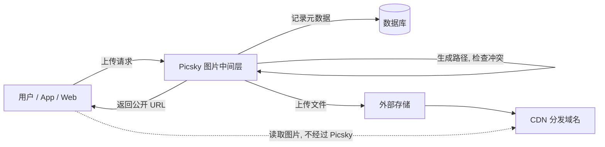

# Picsky

运行在服务器上的图片上传中间层与管理系统, 通过 WebUI 和 REST API 对用户提供服务.
图片只写入外部存储后端, 由对象存储或 CDN 域名对外分发; Picsky 负责认证, 路径生成, 冲突检查, 元数据记录与 URL 返回.

当前状态: 后端与 WebUI 已实现 (M1-M6 主体能力), 前端工程位于独立目录 `web/`, 构建产物由 `go:embed` 内嵌进单个二进制.

## 快速开始

```sh
cp .env.example .env                 # 至少填写 PICSKY_SECRET_KEY 与 POSTGRES_PASSWORD
mkdir -p data                        # 应用容器以 uid 1000 运行, 需要可写 ./data
docker compose up -d                 # 使用 ghcr.io/yeqingky/Picsky:latest + 编排内 PostgreSQL
# 或本地构建
docker compose -f docker-compose-dev.yml up -d --build
```

数据目录 (挂载在宿主机):

| 宿主目录 | 容器内 | 用途 |
| --- | --- | --- |
| `./data` | `/data` | 上传处理期临时文件 (`/data/tmp`); 非 1000 用户请 `sudo chown 1000:1000 data` |
| `./data/_postgres` | `/var/lib/postgresql` | PostgreSQL 数据 (镜像默认 PGDATA 位于其下); 官方镜像以 root 启动时会自动创建并修正属主; `_` 前缀让 Go 工具链忽略该目录 |

容器编排默认使用 PostgreSQL (`PICSKY_DB_DRIVER=postgres`); 切回单文件 SQLite 时同时设置 `PICSKY_DB_DRIVER=sqlite` 与 `PICSKY_DB_DSN=/data/picsky.db`.

启动后访问 `http://127.0.0.1:5214`, 首个注册账号自动成为管理员.

本地开发 (不经容器, 默认 SQLite):

```sh
./scripts/build.sh                   # 前端 + 后端完整构建 (可选)
go run ./cmd/picsky                  # 后端, 默认监听 127.0.0.1:5214
cd web && npm run dev                # 前端 dev server, 代理 /api 与 /lsky 到后端
```

## 核心约束

1. 不做图片本地存储
   - 不提供本地文件系统存储驱动.
   - 图片内容只写入外部存储后端.
   - 处理期间允许内存或临时文件缓冲, 上传结束后立即删除, 系统中不保留任何持久图片副本.
2. 不做公开访问
   - 中间层不提供公开的图片内容路由, 不承载图片分发, 不生成指向本服务的图片 URL.
   - 没有面向访客的图片内容入口: 不做分享页, 不做匿名读取.
   - 未认证入口只有登录, 注册与运维 `health`; 其余接口一律要求认证.
   - 返回给调用方的 URL 一律是外部存储或 CDN 的 URL.

## 架构概览



## 主要能力

- 多用户与用户组: 权限位, 配额, 组内可用存储策略白名单.
- 多存储策略: 每个策略一个存储后端, 一个魔法路径模板, 多个分发域名.
- 魔法路径: 只由内容决定的路径模板, 例如 `{md5:2}/{md5}.{ext}`; 同一内容复用同一个对象键与 URL.
- 分发域名别名: 每个策略可配置多个 "别名 + URL", 例如 `融合CDN -> https://cdn.yppp.net/image/`.
- 完整元数据: md5, sha256, sha512, 大小, 真实格式, 扩展名, 宽高, 原始文件名.
- 冲突检查与秒传: 同哈希复用已有对象与 URL, 不重复上传; 复用记录不占配额, 记录仍按用户隔离.
- WebUI: 上传, 图库, 密钥管理, 管理后台; 全站骨架屏扫光加载态; 图库瀑布流支持滚动加载更多.
- 客户端兼容: PicGo / PicList 自定义图床, Lsky Pro v1 全套接口 (策略, 上传, 列表, 删除, 虚拟默认相册, 资料).
- 注册与安全: 首个注册账号为管理员; 可选邮箱验证; 可选接入 Cap / Cloudflare Turnstile 人机验证 (默认关闭).
- 维护: 策略首次接入自动扫描已有文件 (非图片文件也记录路径), 维护任务队列支持手动清理并为 CDN 刷新预留.

## 文档索引

| 文档 | 内容 |
| --- | --- |
| [docs/architecture.md](docs/architecture.md) | 系统架构, 上传流程, 安全设计, 部署拓扑 |
| [docs/tech-stack.md](docs/tech-stack.md) | 技术选型建议, 仓库结构, 构建约定 |
| [docs/database.md](docs/database.md) | 数据模型, 表结构, 索引, 系统设置项 |
| [docs/storage-policy.md](docs/storage-policy.md) | 存储策略, 魔法路径, 分发域名, 冲突与秒传 |
| [docs/api.md](docs/api.md) | REST API, 认证方式, 错误码, 客户端兼容 |
| [docs/lsky-compat.md](docs/lsky-compat.md) | Lsky Pro API 兼容层: 路由覆盖, 字段映射, 虚拟默认相册, 语义差异 |
| [docs/permissions.md](docs/permissions.md) | 用户, 用户组, 权限位, 配额, 多租户 |
| [docs/webui.md](docs/webui.md) | 页面结构, 交互行为, 权限可见性 |
| [docs/roadmap.md](docs/roadmap.md) | 里程碑与交付顺序 |
| [docs/open-questions.md](docs/open-questions.md) | 待讨论与待确认事项 |

## 许可

见 [LICENSE](LICENSE).
